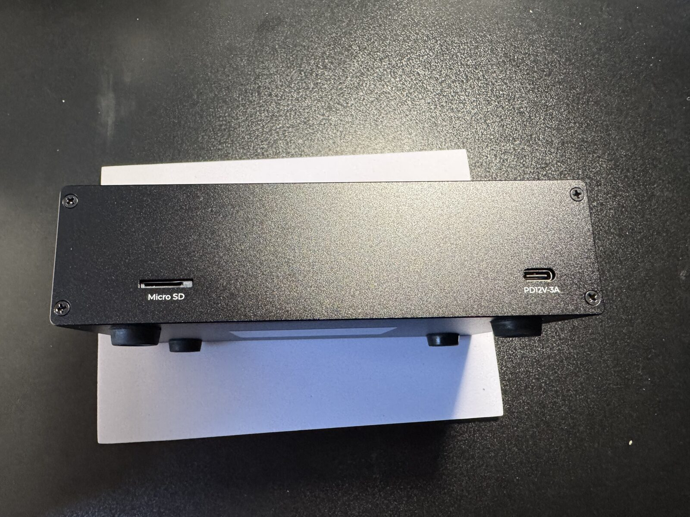
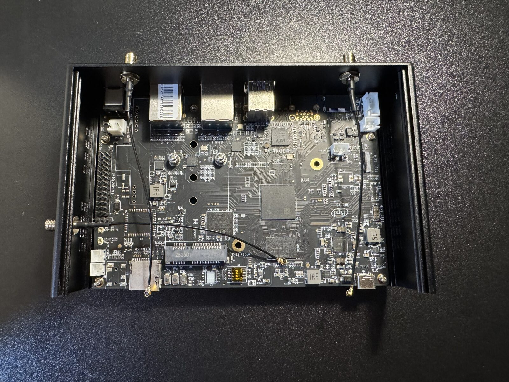
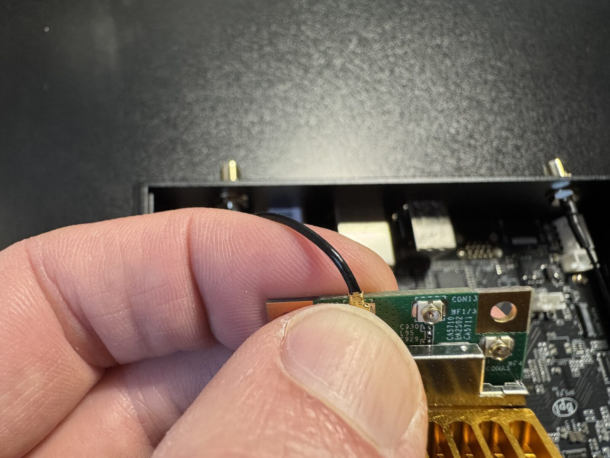
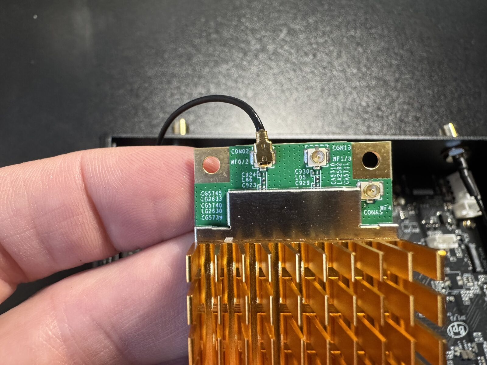
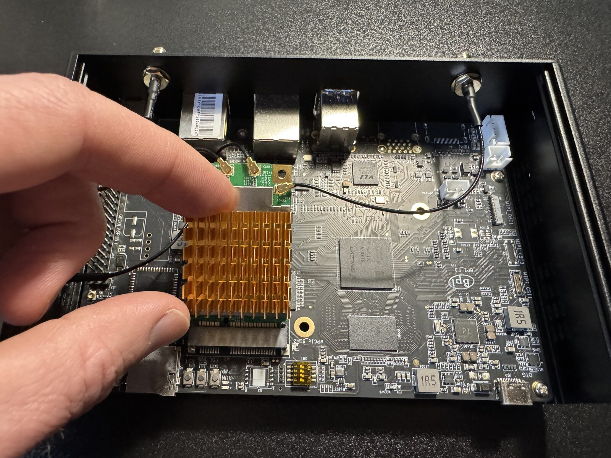
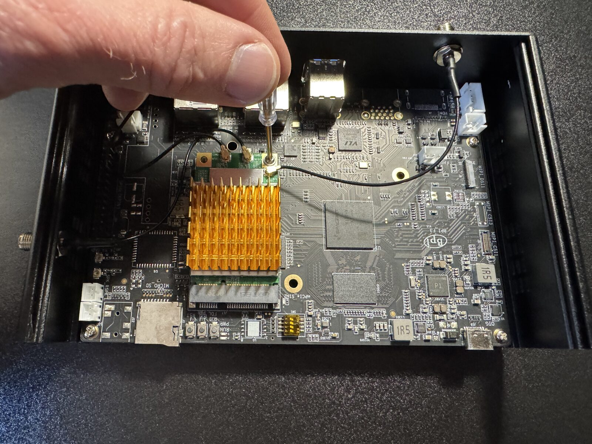
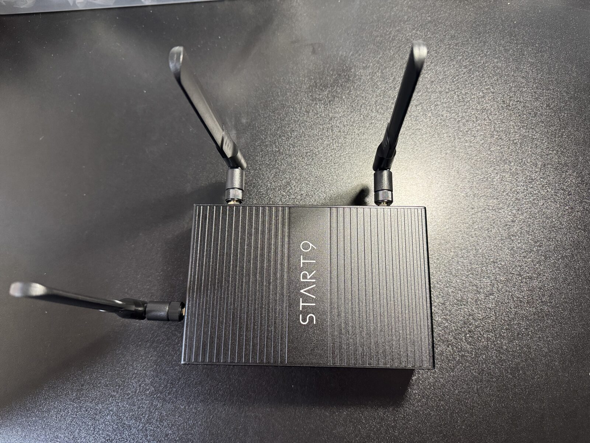

# Installing the Wi-Fi Module

If you bought a Start9 router in the United States, it arrives as a wired router and gets its Wi-Fi from a small module you install yourself. This guide walks you through installing it safely. It takes about fifteen minutes.

## Why Wi-Fi Ships Separately in the US

In March 2026 the FCC added routers produced outside the United States to its [Covered List](https://www.fcc.gov/supplychain/coveredlist). Our router was designed and ordered before that change, so in the US we sell it as a wired router, a small computer running StartWRT, with an FCC-certified Wi-Fi module available separately. Outside the US, routers ship with the module already installed.

Further reading:

- [FCC Public Notice DA 26-278: Addition of routers produced in foreign countries to the Covered List](https://docs.fcc.gov/public/attachments/DA-26-278A1.pdf)
- [FCC: FAQs on the Covered List update for routers produced in foreign countries](https://www.fcc.gov/faqs-recent-updates-fcc-covered-list-regarding-routers-produced-foreign-countries)
- [Mayer Brown: FCC expands its Covered List to include foreign-produced routers](https://www.mayerbrown.com/en/insights/publications/2026/03/fcc-expands-its-covered-list-to-include-foreign-produced-routers)

## Which Wi-Fi Modules Work

The router takes a **mini PCIe** Wi-Fi module with a MediaTek **MT7916** chipset, such as the AsiaRF AW7916-NPD we sell. StartWRT broadcasts on 2.4 GHz and 5 GHz at the same time.

In the US, choose a module with an FCC ID printed on it. The AW7916-NPD's is TKZAW7916-NPD.

## Before You Start

You need the router, the Wi-Fi module, the small screwdriver that came in the router's box, and a clean, dry, well-lit table. A small bowl for the screws helps.

> [!WARNING]
> Static electricity can destroy the module. Work on a hard table, not on carpet or a bed. Before you take the module out of its bag, touch a bare metal object such as a metal table leg or a radiator, and touch it again if you get up and walk around. Hold the module by its edges, and do not touch the gold contacts or the chips.

> [!WARNING]
> The antenna connectors are tiny and delicate. They snap on by pressing straight down and come off by lifting straight up. Never pull on a wire to remove its connector, never press at an angle, and never force one. If it doesn't click on, lift it off and line it up again.

## Installing the Module

1. **Unplug everything.** Disconnect the power cable and every Ethernet and USB cable from the router.

1. **Remove the four screws on the front.** Use the screwdriver from the box, and put the screws in your bowl.

   

1. **Slide the top off.** The top slides off easily. Inside you will see the empty mini PCIe slot and three antenna wires hanging loose from the antenna mounts.

   

1. **Attach the three antenna wires to the module.** This is the fiddliest step, and it is easier with the module in your hand than in the router. Touch bare metal, take the module out of its bag, and hold it by its edges. For each wire, set the connector squarely over one of the module's antenna sockets and press straight down with a fingertip until it clicks. A seated connector sits flat on its socket.

   If your module has fewer than three sockets, leave the extra wire unconnected and tuck it away from the board.

   

   

1. **Insert the module into the slot.** Hold the module at a slight angle, with its gold contacts toward the slot, and slide it in until the contacts disappear. Then press the free end down flat against its screw mount. It only fits one way; if it doesn't go in easily, check that the notch in the contacts lines up with the slot.

   

1. **Screw the module down.** Use the same screwdriver. Snug is enough; do not overtighten.

   

1. **Check the wires, then close the case.** Make sure all three connectors are still seated and no wire sits where the top could pinch it. Slide the top back on and put the four screws back in.

1. **Screw on the antennas.** Screw an antenna onto each antenna mount, finger-tight.

   

1. **Power on.** Reconnect your cables and power. Your Wi-Fi network appears once the router has started. Continue with [Initial Setup](initial-setup.md).

## If Wi-Fi Doesn't Appear

- **No Wi-Fi network at all:** unplug the router, open it again, and check that the module is fully inserted and screwed down.
- **Weak or patchy signal:** first check the settings under `Points of Entry > Wi-Fi > Settings` (see [Wi-Fi](wifi.md#settings)). Make sure **Country** is set to where the router is. Until it is, the router uses a restricted set of channels at reduced power. Then try a different channel: on 2.4 GHz use 1, 6, or 11, and on 5 GHz try one from 149–165.
- **Still weak after that:** an antenna connector may have come off its socket. Unplug the router, open it, and press each one back down until it clicks.
- **Still stuck:** [contact us](https://start9.com/contact/), and we will help you through it.
